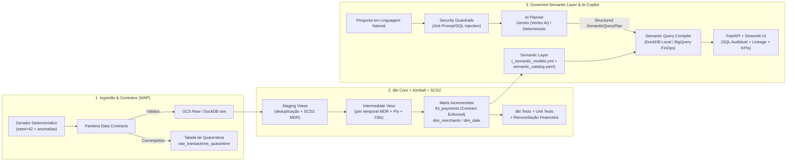

# Payments Semantic AI Platform

[](https://github.com/GabrieelMelo97/payments-semantic-ai-platform/actions/workflows/ci.yml)


> **Resumo Executivo:** Plataforma de **Analytics Engineering & IA Governada** para FinTech de Pagamentos (Adquirência), combinando **modelagem Kimball com SCD Type 2 (dbt Core)**, **Camada Semântica governada (MetricFlow)**, **Copiloto Analítico com Gemini (Vertex AI)** com **0% de alucinação de fórmula financeira** e **Infraestrutura GCP serverless em Terraform modular** — com **paridade 100% local em DuckDB (custo \$0)** para CI e avaliação instantânea.

---

## 1. Contexto de Negócio & Problema

- **Cenário:** Times de Finanças, Risco de Fraude e Produto em uma adquirente de pagamentos investigam diariamente variações de **TPV**, **Net Take-Rate**, **Taxa de Aprovação**, **Chargeback Rate** e **Margem Líquida por MCC e Região**.
- **Dor Principal:**
  1. Soluções de **Text-to-SQL puro** com LLMs alucinam regras contábeis críticas (ex.: somar transações `declined`/`refunded` no TPV, calcular média de médias em ratios ou causar *fan-out* ao cruzar chargebacks).
  2. Renegociações comerciais alteram a taxa **MDR** (*Merchant Discount Rate*) ao longo do tempo — sem **SCD Type 2**, reprocessamentos históricos corrompem a receita passada.
  3. Dados brutos contêm duplicatas de gateway, registros corrompidos e chargebacks atrasados (*late-arriving facts* de até 30 dias).
- **KPIs-Alvo & Critérios de Sucesso:**
  - **0% de alucinação de fórmula:** toda pergunta feita à IA é compilada exclusivamente sobre métricas governadas da Semantic Layer.
  - **100% de reconciliação contábil:** `Approved TPV - MDR Fee - Chargeback Loss == Net Merchant Settlement` validado em todo `dbt build`.
  - **Detecção proativa de risco:** identificar verticais acima do limiar de bandeira (**100 bps** de Chargeback Rate).

---

## 2. Arquitetura End-to-End (Local-to-GCP Parity)



### Stack Tecnológica

| Camada | Local-First (Custo \$0) | GCP Produção (Terraform IaC) | Motivo da Escolha |
| :--- | :--- | :--- | :--- |
| **Contratos & Quarentena** | Pandera + Parquet | Pandera + Cloud Storage (GCS) | Padrão Write-Audit-Publish impedindo dados corrompidos na camada analítica |
| **Warehouse** | DuckDB | BigQuery (particionado + clustered) | Paridade ANSI SQL entre dev/CI local e escala serverless em nuvem |
| **Transformação & SCD2** | dbt Core + `dbt-duckdb` | Cloud Run Jobs + `dbt-bigquery` | Modelagem Kimball, snapshots SCD2, Model Contracts e `dbt unit tests` |
| **Semantic Layer** | MetricFlow YAML + Compiler | MetricFlow YAML + BigQuery FinOps | Fonte única da verdade para métricas simples, ratios e derivadas |
| **AI Analytics Copilot** | Deterministic Planner (CI) | Gemini (`google-genai` via Vertex AI) | Structured Output estrito (zero SQL livre gerado por LLM) |
| **Serving & BI** | FastAPI + Streamlit | Cloud Run (scale-to-zero) | API REST auditável + dashboard executivo interativo |
| **IaC & FinOps** | `terraform fmt/validate` | Terraform Modular + Budget Alerts | Least Privilege IAM, zero chaves estáticas e custo previsível |

---

## 3. Decisões Arquiteturais & Trade-offs (ADRs)

Todas as decisões técnicas críticas estão documentadas em [`docs/adr/`](./docs/adr/):

- **[ADR-001 — Governed Semantic Layer vs. Raw Text-to-SQL](./docs/adr/001-governed-semantic-layer-vs-text-to-sql.md):** Por que o LLM emite apenas um `SemanticQueryPlan` tipado em vez de SQL livre, eliminando alucinação de ratios e SQL injection.
- **[ADR-002 — Arquitetura GCP Serverless, Terraform Modular & FinOps](./docs/adr/002-gcp-architecture-iac-and-finops.md):** Por que Cloud Run Jobs + Cloud Run Service + BigQuery com `maximum_bytes_billed` superam Cloud Composer/GKE em custo-benefício.
- **[ADR-003 — Modelagem Kimball com SCD Type 2 (MDR) e Paridade Local-to-Cloud](./docs/adr/003-kimball-scd2-and-local-cloud-parity.md):** Como o join temporal de tarifas históricas protege backfills contábeis e mantém compatibilidade DuckDB/BigQuery.

---

## 4. Qualidade de Dados, Testes & Resultados Obtidos

### Gates Automatizados Validados Localmente
- **Pandera Data Contracts & Quarentena:** 6.120 registros brutos gerados → **6.090 válidos** carregados e **30 registros corrompidos** (valores negativos / status inválidos) isolados em `raw.raw_transactions_quarantine` (taxa de quarentena: `0.49%`).
- **dbt Build Completo:** **50/50 nodes passando (`PASS=50 WARN=0 ERROR=0`)**, incluindo:
  - 1 modelo incremental (`fct_payments`) com **`contract: {enforced: true}`** e `on_schema_change='fail'`
  - 1 snapshot SCD Type 2 (`snap_merchant_mdr_rates`)
  - **1 dbt Unit Test** validando regra de negócio de Pix (35% MDR, 0% intercâmbio) e impacto de chargebacks perdidos
  - **38 Data Tests**, incluindo testes singulares de **reconciliação financeira** (`assert_financial_reconciliation`) e **deduplicação/idempotência** (`assert_no_duplicate_transactions`)
  - 11 métricas MetricFlow sincronizadas por teste automatizado com `contracts/semantic_catalog.yaml`
- **Pytest + AI Copilot Eval Suite:** **17/17 testes passando**, cobrindo acurácia NL-to-Metrics (PT/EN), bloqueio de *prompt injection* e *SQL injection*, rejeição de métricas alucinadas e integração FastAPI.
- **Linters & IaC:** `ruff check`, `ruff format --check`, `sqlfluff lint` (com `dbt templater`), `terraform fmt -check` e `terraform validate`: **0 erros**.

### Principais Achados Analíticos (Snapshot Real em [`docs/assets/executive_metrics_snapshot.md`](./docs/assets/executive_metrics_snapshot.md))

| KPI Consolidado (90 dias) | Valor Governado |
| :--- | ---: |
| **Gross TPV (Aprovado)** | R\$ 2.326.595,41 |
| **Net Revenue (Margem Líquida)** | R\$ 4.259,14 |
| **Net Take-Rate** | **18.31 bps** |
| **Approval Rate** | **89.85%** |
| **Chargeback Rate** | **100.11 bps** *(acima do limiar de 100 bps!)* |
| **Transações Deduplicadas** | 6.000 |

**Insight Executivo Acionável:** A vertical **`electronics`** (R\$ 908 mil em TPV) concentra **190.7 bps** de Chargeback Rate — quase **2x o limiar de risco das bandeiras** — gerando Net Take-Rate negativo de **-73.4 bps** e arrastando a região Sudeste para margem negativa (`-22.8 bps`). Em contrapartida, **`grocery`** entrega **+126.4 bps** de margem líquida com **0.0 bps** de chargeback. O Copiloto de IA sinaliza automaticamente esse alerta de risco em consultas por MCC/região.

---

## 5. Estrutura do Repositório

```text
payments-semantic-ai-platform/
├── .github/workflows/ci.yml       # CI: ruff, sqlfluff, dbt build, pytest/AI Evals, Terraform + Trivy
├── contracts/
│   ├── raw_payments_contract.yaml # Data Contract explícito (schemas, SLAs, domínios)
│   └── semantic_catalog.yaml      # Catálogo da Semantic Layer sincronizado com MetricFlow
├── dbt_project/
│   ├── macros/                    # generate_schema_name (paridade local/BigQuery)
│   ├── snapshots/                 # snap_merchant_mdr_rates.sql (SCD Type 2)
│   ├── models/
│   │   ├── staging/               # stg_merchants, stg_merchant_mdr_history, stg_transactions, stg_chargebacks
│   │   ├── intermediate/          # int_transactions_enriched.sql + dbt Unit Test
│   │   └── marts/                 # fct_payments (incremental + contract), dim_*, _semantic_models.yml, _exposures.yml
│   └── tests/                     # Reconciliação financeira e garantia de deduplicação
├── docs/
│   ├── adr/                       # Architecture Decision Records (ADR-001 a ADR-003)
│   └── assets/                    # Snapshot executivo real gerado pela Semantic Layer
├── infra/terraform/
│   ├── environments/dev/          # Composição de ambiente + tfvars/backend examples (sem credenciais)
│   └── modules/                   # storage, warehouse, security, compute, finops
├── src/payments_platform/
│   ├── data_generator.py          # Gerador determinístico (seed=42) com sujeiras controladas
│   ├── ingestion.py               # Validação Pandera + Quarentena + Loader DuckDB/BigQuery
│   ├── semantic/                  # Catálogo e Compilador Semântico determinístico (DuckDB/BigQuery)
│   ├── ai/                        # Guardrails + Governed AI Copilot (Gemini Vertex AI + Fallback CI)
│   ├── api/main.py                # FastAPI (/health, /metrics/catalog, /metrics/query, /copilot/ask)
│   ├── app/streamlit_app.py       # UI Executiva + Copiloto Conversacional com auditoria de SQL
│   └── cli.py                     # CLI unificada (generate, ingest, ask, report)
├── tests/                         # Testes de contratos, idempotência, Semantic Engine, AI Evals e API
├── Dockerfile & docker-compose.yml
├── Makefile
└── pyproject.toml
```

---

## 6. Como Executar Localmente (Quickstart — Custo \$0)

Pré-requisitos: **Python 3.10+** e **[`uv`](https://docs.astral.sh/uv/)** (recomendado).

### Linux / macOS (via `Makefile`)
```bash
git clone https://github.com/GabrieelMelo97/payments-semantic-ai-platform.git
cd payments-semantic-ai-platform
cp .env.example .env

make setup
make run      # Gera dados -> Valida/Quarentena -> dbt build (50/50) -> Snapshot executivo
make lint     # ruff + sqlfluff
make test     # pytest + AI Copilot Evals
make ui       # Sobe o dashboard & AI Copilot em http://localhost:8501
```

### Windows (PowerShell)
```powershell
git clone https://github.com/GabrieelMelo97/payments-semantic-ai-platform.git
cd payments-semantic-ai-platform
Copy-Item .env.example .env

# Dica: --no-editable evita problemas de encoding em caminhos Windows com acentos (ex.: Área de Trabalho)
uv sync --extra dev --no-editable
uv run --no-sync python -m payments_platform.cli generate
uv run --no-sync python -m payments_platform.cli ingest
uv run --no-sync dbt build --project-dir dbt_project --profiles-dir dbt_project --target local
uv run --no-sync python -m payments_platform.cli report
uv run --no-sync pytest

# Perguntar ao AI Copilot direto pela CLI:
uv run --no-sync python -m payments_platform.cli ask "Qual o chargeback rate por categoria MCC?"

# Ou subir a interface Streamlit:
uv run --no-sync streamlit run src/payments_platform/app/streamlit_app.py
```

---

## 7. Deploy na Cloud (GCP + Terraform IaC), Segurança & FinOps

- **Provedor & IaC:** Google Cloud Platform (GCP) + **Terraform 1.6+** modular em [`infra/terraform/`](./infra/terraform/).
- **Segurança (Least Privilege):**
  - `sa-payments-ingest`: escrita restrita ao bucket GCS raw e dataset `payments_raw`.
  - `sa-payments-dbt-runner`: leitura em `payments_raw`, escrita em `stg`/`int`/`marts`/`snapshots`.
  - `sa-payments-ai-copilot`: **somente leitura** em `payments_marts` + `roles/aiplatform.user` (Vertex AI Gemini).
  - Zero chaves JSON estáticas — autenticação via **Application Default Credentials (ADC)** e **Workload Identity Federation (OIDC)** no CI/CD.
- **FinOps & Estimativa de Custo (Ambiente `dev`):**
  - BigQuery: Free Tier cobre 10 GB de armazenamento e 1 TB/mês de queries (`maximum_bytes_billed = 100 MB` por query do Copilot).
  - GCS: bucket privado com lifecycle automático (Coldline em 60d, expiração em 180d) → **< US\$ 0.05/mês**.
  - Cloud Run (`min_instance_count = 0`, scale-to-zero) + Artifact Registry → **US\$ 0–2/mês** sob baixo tráfego.
  - Vertex AI (`gemini-2.5-flash`) → **< US\$ 1/mês** para centenas de consultas analíticas.
  - **Total estimado em `dev`: ~US\$ 1–5/mês** (com módulo opcional de `google_billing_budget` alertando em 50%, 80% e 100%).

```bash
cd infra/terraform/environments/dev
cp terraform.tfvars.example terraform.tfvars   # Preencha seu project_id (arquivo gitignored)
terraform init
terraform fmt -check -recursive ../..
terraform validate
terraform plan
# terraform apply     # Provisiona GCS, BigQuery, Service Accounts, Artifact Registry e Cloud Run
# terraform destroy   # Remove todos os recursos para zerar custos
```

---

## 8. Como Escalar para Produção (Visão Staff)

- **Orquestração & Slim CI:** Agendar o **Cloud Run Job** via Cloud Scheduler + configurar Slim CI no GitHub Actions (`dbt build --select state:modified+`) usando manifest em GCS.
- **Governança Avançada:** Adicionar **BigQuery Policy Tags** (Data Catalog) para mascaramento de PII e **Authorized Views** por equipe de negócio.
- **Observabilidade de IA & Dados:** Persistir telemetria de cada pergunta do Copilot (latência, bytes escaneados, métricas consultadas, feedback 👍/👎) em tabela dedicada no BigQuery e expandir a suíte de **AI Evals** com casos reais de regressão.
